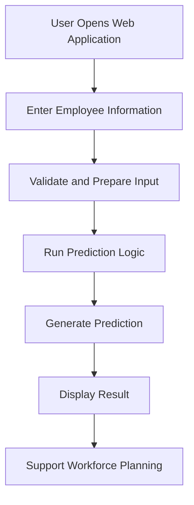

# 🏢 Employee Leave Prediction System

### Predicting Employee Leave Patterns Using Data-Driven Insights

An intelligent web application designed to predict employee leave patterns using employee-related information and predictive analytics. The project demonstrates how data-driven technologies can support HR teams in understanding employee leave behavior and improving workforce planning.

<p align="center">

  <a href="https://employee-leave-prediction-omega.vercel.app/">
    <strong>🚀 Live Demo</strong>
  </a>
  &nbsp; | &nbsp;
  <a href="https://github.com/Siddhesh030/Employee-leave-Prediction">
    <strong>💻 GitHub Repository</strong>
  </a>

</p>

---

## 📌 Table of Contents

- [Overview](#-overview)
- [Problem Statement](#-problem-statement)
- [Project Objectives](#-project-objectives)
- [Features](#-features)
- [How It Works](#-how-it-works)
- [Technology Stack](#-technology-stack)
- [Application Workflow](#-application-workflow)
- [Project Structure](#-project-structure)
- [Getting Started](#-getting-started)
- [Running the Project Locally](#-running-the-project-locally)
- [Deployment](#-deployment)
- [Use Cases](#-use-cases)
- [Limitations](#-limitations)
- [Future Improvements](#-future-improvements)
- [Contributing](#-contributing)
- [Author](#-author)
- [License](#-license)

## 📖 Overview

The **Employee Leave Prediction System** is a web-based project focused on applying predictive analytics to employee leave-related data.

Employee leave patterns can affect workforce availability, team productivity, project schedules, and operational efficiency. By analyzing relevant employee information, a prediction system can help organizations identify potential leave patterns and support better workforce planning.

The project combines a web interface with a prediction workflow to demonstrate how employee-related data can be used to generate useful insights.

**Project links:**

- 🌐 Live Application: https://employee-leave-prediction-omega.vercel.app/
- 📂 Source Code: https://github.com/Siddhesh030/Employee-leave-Prediction

## 🎯 Problem Statement

Managing employee leave is an important responsibility for HR departments and team managers. Unexpected or poorly anticipated absences can create scheduling challenges, increase workloads for other employees, and affect business operations.

Traditional workforce planning often relies on historical records and manual analysis. These approaches may make it difficult to identify patterns consistently.

This project explores the use of predictive technology to analyze relevant employee information and estimate leave-related outcomes, helping demonstrate a more data-driven approach to workforce planning.

## 🎯 Project Objectives

- Develop a web-based interface for employee leave prediction.
- Explore how employee-related data can support predictive analysis.
- Simplify the process of submitting information and viewing prediction results.
- Demonstrate the practical application of data science and web development.
- Support data-informed workforce planning and HR analytics.
- Build a publicly accessible application that users can explore online.

## ✨ Features

### 🔮 Employee Leave Prediction

The application is designed around an employee leave prediction workflow, allowing users to interact with the interface and obtain the prediction supported by the implemented model.

### 🖥️ Web-Based Interface

Access the application through a web browser without requiring users to set up the development environment.

### 📊 Data-Driven Analysis

The project demonstrates the use of employee-related information for predictive analysis and potential workforce planning insights.

### ⚡ Online Accessibility

The application is deployed online, making it easy to explore the project from different devices with an internet connection.

### 🧩 Modular Project Design

The project source code is available on GitHub for review, learning, experimentation, and future development.

> **Note:** The exact prediction fields, model type, metrics, and additional interface capabilities should be documented according to the implementation in the repository.

## ⚙️ How It Works

The general prediction workflow can be described as follows:

1. **Input:** The user provides the employee information requested by the application.
2. **Preprocessing:** The application prepares the input in the format required by the prediction logic.
3. **Prediction:** The implemented model or prediction mechanism processes the information.
4. **Output:** The application presents the resulting leave-related prediction.
5. **Interpretation:** The result can be used as an informational input for workforce planning.



The diagram represents the general workflow. The actual implementation may differ depending on the application's code.

## 🛠️ Technology Stack

The technologies used in the project should be verified against the repository files.

| Component | Purpose |
|---|---|
| Frontend | User interface and interaction |
| Prediction logic | Generate employee leave predictions |
| Data processing | Prepare input data for prediction |
| Deployment | Publish the application online |
| Git and GitHub | Version control and source code hosting |
| Vercel | Hosting platform used for the live application URL |

**Potential machine learning tools**, if used by the implementation, include Python, Pandas, NumPy, and Scikit-learn. Add them to the confirmed technology list only if they are part of the actual project.

## 🔄 Application Workflow

The application follows a user-oriented workflow:

- Open the live application.
- Review the available input fields and instructions.
- Enter the required employee information.
- Submit the information using the available interface.
- Review the generated prediction.
- Use the result as a reference for further analysis.

The exact interaction steps depend on the deployed version of the application.

## 📁 Project Structure

The repository structure depends on the actual files committed to GitHub. A typical structure for a web-based prediction project might look like this:

```text
Employee-leave-Prediction/
│
├── public/                 # Static assets, if applicable
├── src/                    # Application source code, if applicable
├── components/             # Reusable UI components, if applicable
├── pages/                  # Application pages, if applicable
├── models/                 # Prediction model files, if applicable
├── data/                   # Data files, if applicable
├── package.json            # JavaScript project dependencies, if applicable
├── requirements.txt        # Python dependencies, if applicable
├── .gitignore              # Files excluded from version control
└── README.md               # Project documentation
```

This is an illustrative structure, not a verified listing of the repository. Keep only the directories and files that actually exist in your project.

## 🚀 Getting Started

You can explore the deployed application directly or clone the repository to inspect and develop the source code.

### Prerequisites

Depending on the technologies used, you may need:

- Git
- A modern web browser
- Node.js and npm for a JavaScript-based application
- Python and pip for a Python-based prediction component
- Any model files, configuration files, or environment variables required by the application

### Clone the Repository

Open a terminal and run:

```bash
git clone https://github.com/Siddhesh030/Employee-leave-Prediction.git
```

Navigate to the project directory:

```bash
cd Employee-leave-Prediction
```

### Install Dependencies

For a Node.js application containing `package.json`:

```bash
npm install
```

For a Python application containing `requirements.txt`:

```bash
python -m venv venv
```

Activate the environment on Windows:

```bash
venv\Scripts\activate
```

Install the Python dependencies:

```bash
pip install -r requirements.txt
```

Use only the installation steps relevant to the actual project. If the repository contains both frontend and backend directories, install dependencies in the appropriate directories.

## 💻 Running the Project Locally

For a typical Node.js application, inspect the available scripts in `package.json`. If a development script is defined, start the application using:

```bash
npm run dev
```

For a Python web application, use the command specified by the project's framework and configuration.

For example, if the application uses Flask and its entry point is `app.py`:

```bash
python app.py
```

The local URL and startup command depend on the framework and project configuration.

## ☁️ Deployment

The project has a live deployment available through Vercel.

**Live application:** https://employee-leave-prediction-omega.vercel.app/

For future deployments or updates:

1. Push the latest source code to the connected GitHub repository.
2. Open the corresponding project in Vercel.
3. Verify the configured build command, output directory, and environment variables.
4. Trigger a new deployment.
5. Open the deployed application and test the prediction workflow.

If the project uses a separate backend or a hosted prediction API, ensure that the backend is deployed and the frontend points to the correct API URL.

## 💼 Use Cases

Potential applications of an employee leave prediction system include:

- **Workforce planning:** Support decisions about employee availability.
- **HR analytics:** Explore patterns in historical employee information.
- **Resource allocation:** Help managers consider possible staffing requirements.
- **Operational planning:** Support planning for teams and project schedules.
- **Predictive analytics education:** Demonstrate how a prediction workflow can be integrated into a web application.

These are potential use cases, not claims that the application has been validated for every scenario.

## ⚠️ Limitations

- Predictions depend on the quality and relevance of the input data.
- Results may not generalize to every organization or workforce.
- Missing, biased, or outdated data can affect prediction quality.
- Prediction accuracy and reliability should be assessed using appropriate evaluation methods.
- A prediction should not be treated as a guarantee of future employee behavior.
- Employee leave predictions should not be used as the sole basis for employment decisions.

## 🔮 Future Improvements

Possible enhancements include:

- 📊 Interactive dashboards for historical leave patterns.
- 📈 Model evaluation with appropriate classification or regression metrics.
- 🧠 Comparison of different prediction algorithms, where applicable.
- 🔍 Model explainability to help users understand prediction factors.
- 📂 Batch prediction for multiple employee records.
- 📉 Historical trend analysis and data visualization.
- 🔐 Authentication and role-based access for authorized HR users.
- 📱 Further improvements to mobile responsiveness and accessibility.
- 🧪 Automated testing and continuous integration.
- 🔒 Improved privacy protections for sensitive employee information.

## 🤝 Contributing

Contributions, suggestions, and improvements are welcome.

To contribute:

1. Fork the repository.
2. Create a new branch.

   ```bash
   git checkout -b feature/your-feature
   ```

3. Implement your changes.
4. Commit your changes.

   ```bash
   git add .
   git commit -m "Add your feature"
   ```

5. Push your branch.

   ```bash
   git push origin feature/your-feature
   ```

6. Open a pull request describing your improvements.

## 👨‍💻 Author

**Siddhesh**

- GitHub: [@Siddhesh030](https://github.com/Siddhesh030)
- Project Repository: [Employee Leave Prediction](https://github.com/Siddhesh030/Employee-leave-Prediction)
- Live Demo: [Employee Leave Prediction Web App](https://employee-leave-prediction-omega.vercel.app/)

## 📄 License

No license has been specified in this documentation. If you want others to reuse, modify, or distribute your code, consider adding an appropriate open-source license, such as the MIT License, to the repository.

## ⭐ Show Your Support

If you find this project useful or interesting, consider giving the repository a ⭐ on GitHub.

**Explore the project:** [Launch Employee Leave Prediction](https://employee-leave-prediction-omega.vercel.app/)
